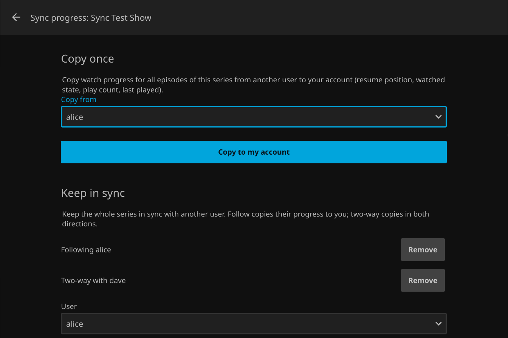

# Progress Sync for Jellyfin

Copy or sync watch progress between users on the same Jellyfin server.

[](https://github.com/lirem/jellyfin-plugin-progress-sync/releases)
[](https://jellyfin.org)
[](LICENSE)



Progress Sync adds a sync button to movie, series, season and episode pages in the Jellyfin web
client. Use it to take over another user's progress once, or to link a title so your progress
stays in step as you watch.

Only watch progress is copied: resume position, watched state, play count and last played date.
Favorites, ratings and audio/subtitle choices are left alone.

## Requirements

- Jellyfin 12.1 or newer
- The [File Transformation](https://github.com/IAmParadox27/jellyfin-plugin-file-transformation)
  plugin, which adds the button to the web client

## Installation

1. In Jellyfin, open **Dashboard → Plugins → Repositories** and add these repositories:

   **File Transformation** (skip if you already have it installed)

   ```
   https://www.iamparadox.dev/jellyfin/plugins/manifest.json
   ```

   **Progress Sync**

   ```
   https://raw.githubusercontent.com/lirem/jellyfin-plugin-progress-sync/main/manifest.json
   ```

2. Install **File Transformation** and **Progress Sync** from the catalog.
3. Restart Jellyfin, then reload the web client.

## Usage

Open a title and click the sync button next to the other actions.

**Copy once** replaces your progress with another user's:

| Page    | What is copied                    |
|---------|-----------------------------------|
| Movie   | the movie, including all versions |
| Episode | that episode                      |
| Season  | the season's episodes             |
| Series  | every episode                     |

**Keep in sync** links the movie, or the whole series, with another user. It first copies their
current progress to you.

- **Follow:** their progress is copied to you as they watch. Only you see this link.
- **Two-way:** progress is copied both ways. You both see the link, and either of you can remove it.

Links pass changes along. If Ann follows Ben and Ben has a two-way link with Cleo, Cleo's progress
reaches Ben and then Ann.

Syncing runs on the server, so progress made in any Jellyfin app is synced. The button itself is
only in the web client. Admins can see all links under **Dashboard → Plugins → Progress Sync**.

## Privacy

Progress Sync is meant for households whose members trust each other:

- Every user can see the other users and copy or follow their progress. People are not told when
  someone follows them.
- With a two-way link, your partner's actions on that title, such as marking it unwatched, change
  your progress too. There is no undo.

Library access and parental controls still apply. Every copy and link change is written to the
server log.

## Known limitations

- The button relies on File Transformation modifying the web client, which Jellyfin does not
  officially support. A future web client update may break the button; existing links keep syncing.
- If two linked users watch the same title at the same time, their positions overwrite each other.
- A show split across two library folders syncs live only for the series the link was created on.

## Troubleshooting

- **No sync button:** check **Dashboard → Plugins → Progress Sync**. If the web client integration
  is inactive, install or enable File Transformation and restart Jellyfin. Then reload the browser
  once with Ctrl+Shift+R (Cmd+Shift+R on macOS).
- **An action fails:** look for `Progress Sync` lines in the Jellyfin log and
  [open an issue](https://github.com/lirem/jellyfin-plugin-progress-sync/issues).

## Building

Requires the .NET 10 SDK.

```sh
dotnet build -c Release
dotnet test -c Release
```

Releases are packaged by the release workflow (see [docs/RELEASING.md](docs/RELEASING.md)).
Design notes are in [docs/ARCHITECTURE.md](docs/ARCHITECTURE.md).

## License

[GPL-3.0](LICENSE)
